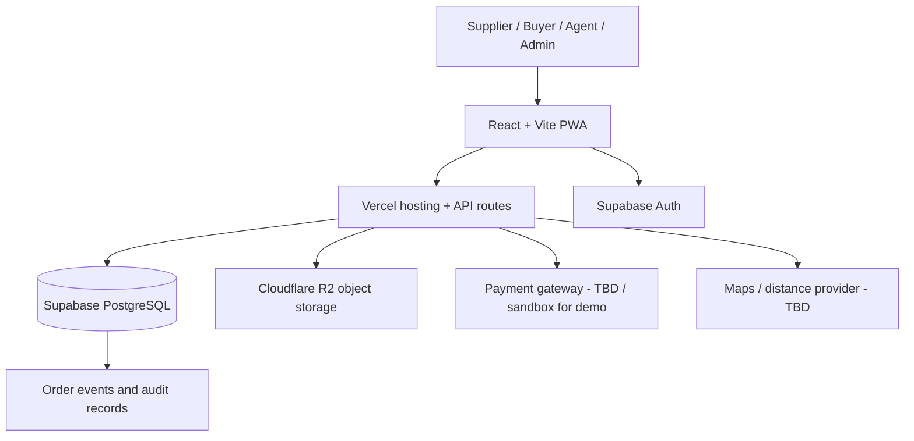

# Kachra To Kamai — System Architecture

- **Document version:** 0.3.0
- **Status:** Local demo foundation implemented; production integration and deployment have not started
- **Last updated:** 2026-10-24

## 1. Architecture goals

- Ship a responsive PWA first.
- Keep the architecture simple enough for a hackathon prototype but structured for later expansion.
- Separate structured records from images and uploaded files.
- Enforce role and category restrictions on the server/database, not only in the UI.
- Keep payment and delivery-provider integrations replaceable because providers and rate cards are not yet selected.

## 2. Logical architecture



The browser must not receive R2 secret access keys, payment secret keys, or a Supabase service-role key. All privileged operations should go through Vercel server-side routes or tightly scoped database policies.

## 3. Technology choices

### Frontend
- React + Vite.
- Tailwind CSS.
- PWA manifest and service worker, with offline behaviour limited to safe shell/cache behaviour until explicitly designed.
- Responsive layouts for mobile, tablet and desktop.
- Shared design tokens with yellow non-organic and green organic themes.

### Hosting and API
- Vercel hosts the frontend and server-side functions/API routes.
- API routes handle sensitive mutations, role validation, order acceptance, price/fee calculations, R2 upload signing, payment verification and administrative actions.
- Validate all client input on the server even if the frontend validates it too.

### Database and authentication
- Supabase PostgreSQL stores records and relationships.
- Supabase Auth provides sign-in and session management.
- PostgreSQL Row Level Security (RLS) must be enabled for tables reachable by browser clients. Policies must be written and tested per role and record ownership.
- Sensitive actions (commission changes, admin overrides, payment confirmation, agent assignment, restricted-category approval) require server-side authorization.

### File storage
- Cloudflare R2 stores listing images and permitted files.
- PostgreSQL stores object keys and metadata, not image binaries.
- Use server-generated short-lived presigned URLs or server-mediated upload/download paths.
- Private documents must not be placed in a public bucket or exposed through permanent public URLs.
- Validate file type, size and filename; use random object keys; never trust a client-provided object key without authorization.

## 4. Suggested module boundaries

```text
src/
  app/                 # route setup, layouts, providers
  components/          # shared controls and marketplace components
  features/
    auth/
    listings/
    buyer-requests/
    orders/
    delivery/
    payments/
    admin/
    categories/
  lib/                 # client config and shared utilities
  styles/              # tokens and theme styles
api/                   # Vercel server-side handlers (exact layout TBD)
supabase/
  migrations/          # reviewed SQL migrations and RLS policies once schema is approved
```

This is an illustrative structure, not a requirement to adopt every directory. Keep features separated enough to prevent business rules from being duplicated across views.

## 5. Proposed data model (conceptual)

| Table / entity | Purpose and key relationships |
|---|---|
| `profiles` | User display/contact fields and account state; associated with Supabase Auth user ID. |
| `user_roles` | Role capabilities; supports the possibility of multiple roles per account. Final account-role policy is TBD. |
| `business_profiles` | Additional information and verification for businesses/plants. |
| `material_categories` | Category definitions, theme, active status and rules reference. |
| `material_rules` | Eligibility and required fields per category; restricted categories default to blocked. |
| `listings` | Seller, category, material details, quantity, unit, price, condition, location and availability. |
| `listing_images` | R2 object keys and image metadata associated with a listing. |
| `buyer_requirements` | Requested category, quantity, grade/specification, delivery area and target date. |
| `orders` | Buyer, seller, listing/requirement, quantities, price snapshots, status and destination. |
| `order_events` | Append-only status history with actor and timestamp. |
| `delivery_agents` | Agent profile, verification and availability. |
| `vehicles` | Vehicle type/capacity and eligibility; sensitive documentation kept private. |
| `delivery_jobs` | Order, agent, vehicle, stops, delivery charge, agent payout and status. |
| `payments` | Provider reference, amount, currency, status, and refund reference. Never store raw card details. |
| `commission_ledger` | Commission calculation and settlement state. |
| `disputes` | Category-specific issue, evidence and resolution record. |
| `audit_logs` | Important administrative/security actions. Avoid logging secrets or unnecessary personal data. |
| `impact_records` | Verified quantity, destination, baseline and measurement method, where available. |

Names are provisional. Do not create tables without reviewing the workflow and data requirements first.

## 6. API responsibilities (initial proposal)

Routes may be grouped as follows; endpoint names are illustrative, not frozen:

- `POST /api/listings` — validate category rules and create listing.
- `GET /api/listings` — search/filter published, eligible listings.
- `POST /api/requirements` — create buyer requirement.
- `POST /api/orders` — create order request with price snapshot.
- `POST /api/orders/:id/accept` — seller acceptance, availability check and order transition.
- `POST /api/orders/:id/cancel` — apply cancellation policy.
- `POST /api/delivery-jobs/:id/status` — authorized agent status update.
- `POST /api/uploads/presign` — issue a short-lived upload URL after authorisation and file validation.
- `POST /api/payments/create` and provider webhook — sandbox/live payment lifecycle, once a provider is selected.
- `POST /api/admin/assign-delivery` — admin/operations assignment of an eligible agent and vehicle.

Critical actions must be idempotent where retries can create duplicate orders, payments or payouts. Price, fee, permissions and category checks must be recalculated on the server.

## 7. Core data and transaction rules

- Material price is set by the seller and captured as a snapshot on the order.
- Delivery fee is estimated from distance, weight and vehicle type; the actual formula/rate card remains TBD.
- Seller commission is a separate ledger item; the percentage or fixed rate remains TBD.
- Bulk logistics charges are separate and must not silently duplicate a delivery charge.
- Do not accept more quantity than is available.
- Confirm order transitions atomically where possible to avoid two buyers acquiring the same inventory.
- An order cannot reach `completed` until delivery/receipt requirements are met.
- Payment is not considered successful because the frontend says so; verify provider state server-side or label it as simulated in demo mode.
- Prohibited/unapproved categories cannot be ordered or assigned to delivery.

## 8. Environment and secrets

Expected configuration categories (actual names to be defined during implementation):

- Public Supabase project URL and publishable/anon key.
- Server-only Supabase service-role credential, only if required and tightly controlled.
- Server-only Cloudflare account/access identifiers and R2 secret key.
- R2 bucket name and optional public asset domain configuration.
- Payment sandbox/live credentials, once selected.
- Maps/geocoding API key, once selected.
- Public app URL and allowed origin/CORS settings.

Use separate development/preview/production settings. Never commit `.env` files containing secrets. A service-role key bypasses RLS and must never be exposed to the browser.

## 9. Current implementation status

The first local prototype slice is implemented as a React + Vite frontend using sample data. It currently demonstrates:

- Responsive PWA shell with install metadata and a conservative shell service worker.
- Yellow non-organic and green organic active-category themes.
- Sample material discovery across approved agricultural, organic, recyclable, reusable and furniture categories.
- Listing detail and buyer request flow with clearly labelled demo delivery estimates.
- Supplier listing form with required-field validation and blocked restricted category.
- Role-switched sample order workflow for buyer, supplier, delivery agent and admin/operations responsibilities.
- Status-based order tracking through seller acceptance, simulated payment, assignment, pickup, delivery and receipt.
- Local-only state; no real account, payment, upload, database, delivery assignment or external transaction is created.
- Demo listings, orders and selected role persist in browser local storage through `src/lib/persistence.js`; this is a reversible development adapter and is not authoritative application data.
- Runtime mode and public configuration are read from `VITE_*` variables through `src/lib/runtime.js`. Production mode must not be treated as ready until Supabase configuration and server-side integrations are present.

The frontend's demo pricing formula is intentionally isolated in `src/data.js` and `src/lib/marketplace.js`. It is sample configuration, not an approved commercial rate card.

## 10. Deployment plan

1. Create/connect the repository and local environment; follow `docs/PRODUCTION_PLAN.md`.
2. Configure Supabase project, schema migrations and RLS.
3. Configure the Cloudflare R2 bucket and secure upload flow.
4. Configure Vercel project and environment variables.
5. Deploy preview builds for testing.
6. Run role-access, prohibited-category, duplicate-order and upload-security tests.
7. Deploy the demo build and test on a real mobile browser.
8. Evaluate TWA or Capacitor only after the PWA is stable.

## 11. Items still open

- Exact frontend, Tailwind and SDK versions.
- Database schema and migration tool.
- Whether reads use Supabase client directly or API routes; sensitive writes must be protected either way.
- Payment gateway and payout/settlement method.
- Distance and map provider.
- Notification channel (in-app, email, SMS or messaging; no provider selected).
- R2 public/private asset policy and any image CDN domain.
- Android packaging strategy.
- Production rollout, monitoring, backups and incident-response ownership; see `docs/PRODUCTION_PLAN.md`.

## 12. Mandatory change tracking

Every architecture, schema, API, security, dependency, environment or deployment change must be added to `CHANGELOG.md` in the same task. If an architecture decision changes, update this document and any impacted documents. See `RULES.md`.
