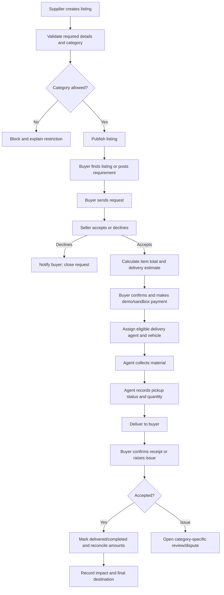

# Kachra To Kamai — Workflows

- **Document version:** 0.1.0
- **Status:** Draft baseline
- **Last updated:** 2026-10-24

## 1. Standard listing-to-delivery workflow

## 2. Supplier listing workflow

1. Supplier signs in.
2. Selects a material category.
3. Enters title, description, available quantity/unit, price, condition, pickup location and availability.
4. Uploads images; the server issues secure R2 upload access.
5. Category rules identify required fields and restrictions.
6. Listing is published only if the category and supplied details pass validation.
7. Listing can be edited, paused, marked unavailable or closed when sold.

**Validation notes:** Do not treat an image as proof that a material is safe or meets buyer specifications. For categories needing objective quality data, capture the relevant fields or require manual review.

## 3. Buyer request and seller acceptance

1. Buyer searches or filters eligible listings, or posts a material requirement.
2. Buyer selects the quantity and destination.
3. Platform checks available quantity, category eligibility and area/vehicle feasibility.
4. Platform displays the material price and provisional delivery estimate.
5. Seller accepts or declines the request.
6. If accepted, availability and the order terms are rechecked and saved as a price/specification snapshot.
7. Buyer reviews final charges and confirms through the demo/sandbox payment path.
8. A delivery job is created only after the order reaches the required confirmed state.

Exact order/payment sequence and instant-purchase eligibility remain open and must be finalised before implementation.

## 4. Organic material workflow

### Direct buyer path
1. Supplier lists eligible organic waste or surplus produce, including quantity, condition, date/availability and intended-use constraints where relevant.
2. Platform seeks buyers with an appropriate intended use.
3. Buyer and seller agree to the material and delivery terms.
4. Agent collects and delivers using suitable handling/vehicle arrangements.
5. Buyer confirms accepted quantity and condition.

### No direct buyer / bulk plant path
1. The listing is not automatically collected simply because it exists.
2. Operations first identifies a suitable plant or buyer and confirms the material is accepted there.
3. Buyer specifies needed quantity, quality, destination and deadline.
4. Platform checks available quantities from multiple suppliers.
5. It calculates collection route, vehicle capacity, handling and delivered cost.
6. Sellers confirm their quantities and terms.
7. Agent collects from the agreed suppliers and follows the planned route to the buyer/plant.
8. Plant confirms delivered and accepted quantity.
9. Financial records and final destination are recorded.

If no suitable buyer or economical route exists, the platform should leave the material uncollected and seek an alternative rather than silently accept inventory risk.

## 5. Reusable product and furniture workflow

1. Seller describes item condition, dimensions/weight if relevant, quantity and pickup constraints.
2. Buyer purchases or requests the item subject to seller acceptance.
3. Platform calculates the appropriate vehicle/handling cost.
4. Agent collects and delivers.
5. Buyer confirms condition at receipt. Category-specific rules govern damage, discrepancy or rejection.

Large furniture may need a different vehicle and handling rate than a small parcel. The exact tariff is still TBD.

## 6. Restricted-material workflow

1. Category and material-specific data are validated before publication/order.
2. If prohibited or not explicitly approved, the listing/order is blocked.
3. No payment, pickup assignment or shipping label is created.
4. If an eligible regulated category is added in the future, the required authorisation, documentation, transporter eligibility and destination checks must first be defined and reviewed.

Chemicals, medicines and other hazardous/prohibited materials are excluded from the normal marketplace. Leftover paint remains blocked unless a material-specific safety/compliance review explicitly allows a particular use case.

## 7. Delivery-agent workflow

1. An agent with an approved profile and suitable vehicle becomes available.
2. Operations/system proposes a job based on location, distance, vehicle type/capacity and material constraints.
3. Agent accepts the job and sees pickup, destination, load details and handling requirements.
4. At pickup, agent records status, timestamp and quantity or discrepancy.
5. Agent updates in-transit status.
6. At delivery, agent records arrival and proof of handover.
7. Buyer confirms receipt or an issue is recorded.
8. Agent payout is calculated using the approved agent rate card. That rate card and payout timing are still to be decided.

## 8. Payment and reconciliation workflow

1. Show the seller-set item price.
2. Calculate delivery fee using the approved distance/weight/vehicle formula.
3. Calculate seller commission separately.
4. Add any agreed bulk logistics charge, without double-counting standard delivery charges.
5. Show total payable and relevant settlement breakdown to the parties.
6. In demo mode, label the transaction as simulated. In live mode, use server-verified payment provider status.
7. On completion/eligible milestone, record seller payable, commission, agent payout, refund or discrepancy as applicable.

Payment provider, taxes, commission rate, settlement timing and refund flow have not been selected; do not fabricate these as final policy.

## 9. Cancellation, rejection and dispute handling

- Every rejection must be tied to the agreed material description, quantity, condition and the relevant category rule.
- Preserve timestamps, photos/evidence where appropriate and the order specification snapshot.
- Don't promise automatic refunds or returns until the rules and payment provider support them.
- A dispute must have a status, responsible reviewer, reason and outcome record.
- Any new or changed rejection/refund rule must be updated in `PRD.md`, `RULES.md`, and this file if affected, then recorded in `CHANGELOG.md`.

## 10. Required demo scenarios

1. Approved non-organic listing → buyer request → seller acceptance → assigned agent → delivery → receipt.
2. Organic listing → direct buyer → delivery.
3. Bulk plant order → compatible pickups from multiple suppliers → one destination.
4. Incompatible/prohibited material → listing or order blocked.
5. Insufficient remaining quantity or two buyers requesting the same stock → only valid available quantity is confirmed.
6. Delivery fee changes when distance, weight or vehicle class changes.
7. Buyer reports a quantity/condition issue → order moves to review rather than auto-completing.
8. Admin views commission, agent payment and final destination in sample records.

## 11. Change history requirement

Whenever any workflow, status, validation or process changes, update this file and any other affected project documentation, then append an entry to `CHANGELOG.md` in the same task. See `RULES.md`.
